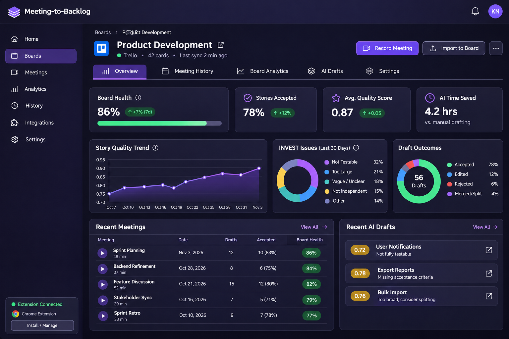
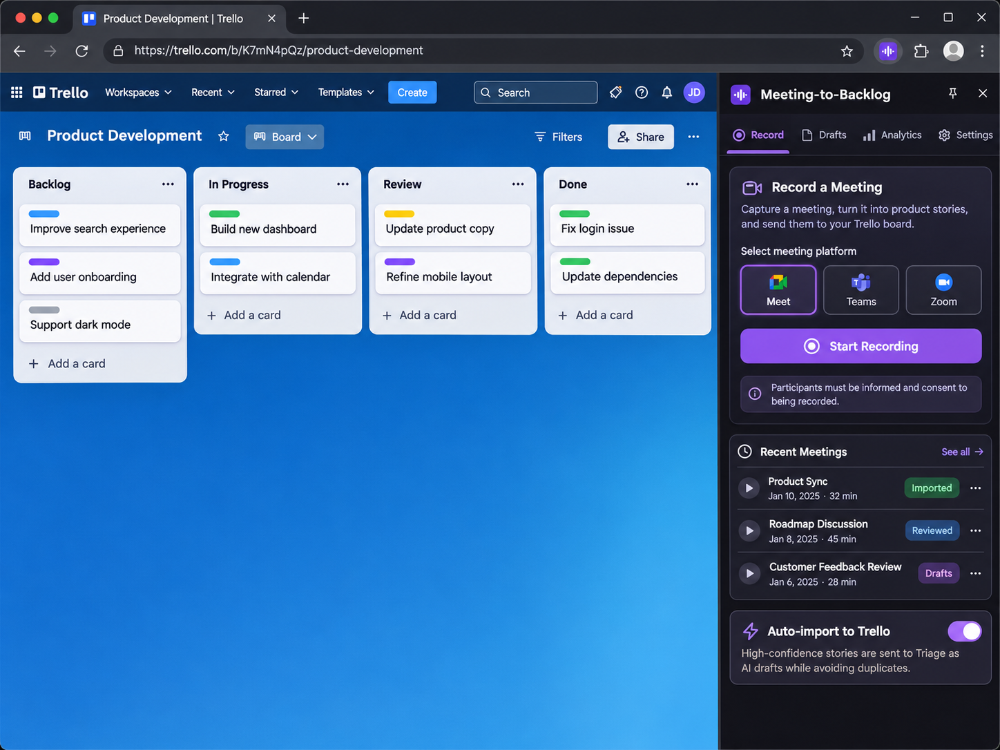
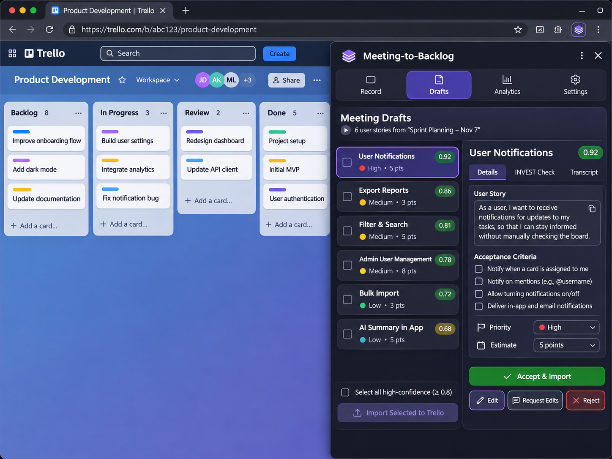
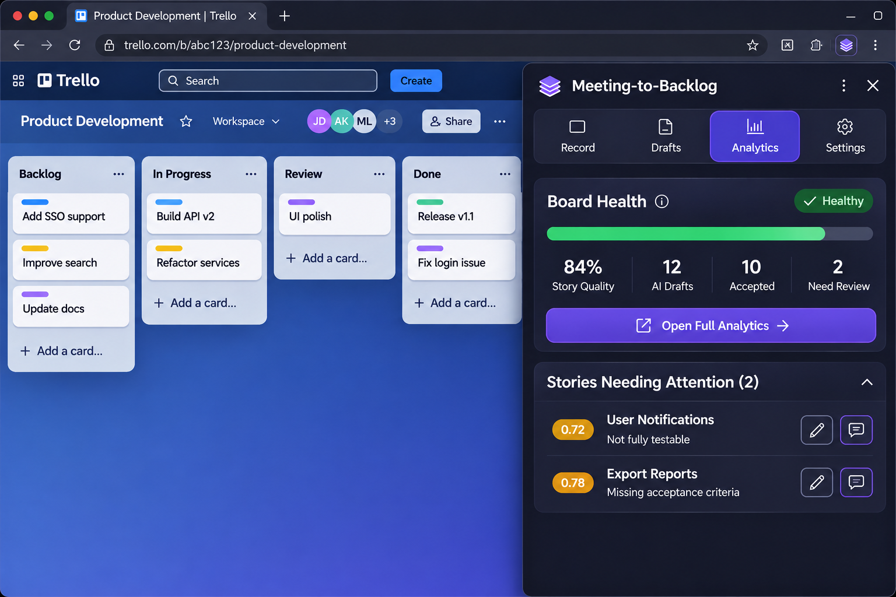
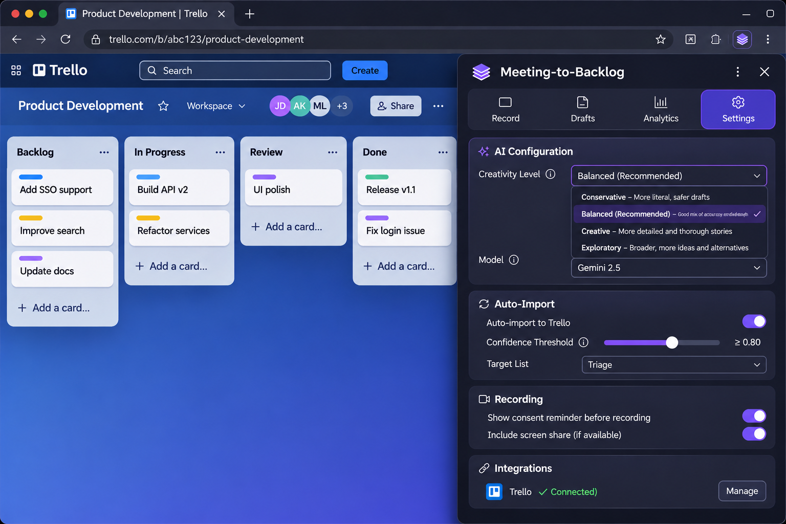

# Backlogger

> Your meeting ends, and your backlog is already drafted, checked, and linked back to the exact moment it was discussed.

A Chrome extension records a browser meeting beside a Trello board or Jira Cloud project. Gemini turns the recording into user stories with source quotes, checked against INVEST. A human reviews them, or confident ones import automatically, and each Trello card or Jira issue links back to the moment it was discussed. A companion web app for meeting history and backlog quality is planned.

**Status:** hackathon prototype. The backend and the extension work together; `apps/web` is not built yet.

Full design: [docs/DESIGN.md](docs/DESIGN.md)
AI usage disclosure (hackathon requirement): [docs/AI_USAGE.md](docs/AI_USAGE.md)

## What it does

- **Record or upload** a meeting from the extension's side panel. Audio is stored locally or in a private Supabase bucket and played back in the panel, including from each evidence quote.
- **Generate stories** with Gemini in four creativity levels, using the board's existing epics and stories as context so new drafts don't duplicate or contradict them.
- **Review drafts** in bulk or one at a time: edit, accept, reject, restore, delete, or ask the AI to revise a draft (it can split one story into several).
- **Import** accepted stories to Trello (with checklists) or Jira Cloud (with required fields). Each connection is scoped to the browser. Optionally, confident stories import automatically.
- **Track quality** with per-board analytics: INVEST scores, draft outcomes, and stories needing attention.
- **Open from Trello or Jira** with a launcher button that opens the side panel.

## Mockups

Design concepts for the companion dashboard and Chrome extension. Screen content
and metrics are illustrative.

### Analytics dashboard



### Meeting recording



### Draft review



### Extension analytics



### Extension settings



## Backend development

The Python backend uses FastAPI and SQLModel with Psycopg 3 against a PostgreSQL
database (TigerData / TimescaleDB). Copy `.env.example` to `.env`, set
`DATABASE_URL` and `GEMINI_API_KEY` (other keys are needed for Trello, Jira and
Supabase; see the guides below), then run:

```powershell
uv venv --python 3.13 .venv
uv pip install --python .venv/Scripts/python.exe -r requirements-dev.txt
./infra/db/setup.ps1 -Action Check
./.venv/Scripts/python.exe -m uvicorn services.api.server:app --reload
```

Apply each migration in `infra/db/` in order before using the API (the two `005`
files are independent):

```powershell
./infra/db/setup.ps1 -Action Apply -Migration 001_initial.sql
```

Check connectivity at `http://127.0.0.1:8000/health/db`. Interactive API
documentation is at `http://127.0.0.1:8000/docs`. SQLModel table mappings are in
`services/models.py`; session handling is in `services/db.py`.

Run the backend tests with `./.venv/Scripts/python.exe -m pytest`. They use
synthetic data and mocked Gemini, Trello, Jira and Supabase calls.

Guides:

- Connect Trello: [docs/TRELLO_CONNECT.md](docs/TRELLO_CONNECT.md); exports and retries: [docs/TRELLO_EXPORTS.md](docs/TRELLO_EXPORTS.md)
- Connect Jira Cloud and export stories: [docs/JIRA_CLOUD.md](docs/JIRA_CLOUD.md)
- Endpoints the extension uses: [docs/FRONTEND_API.md](docs/FRONTEND_API.md)
- Creativity levels and splitting rules: [docs/STORY_CREATIVITY.md](docs/STORY_CREATIVITY.md)
- Board context and embeddings: [docs/BOARD_CONTEXT.md](docs/BOARD_CONTEXT.md)
- Automatic imports: [docs/AUTO_IMPORT.md](docs/AUTO_IMPORT.md)
- Audio storage: [docs/SUPABASE_STORAGE.md](docs/SUPABASE_STORAGE.md)

## Extension development

From `apps/extension`:

```powershell
npm install
npm run dev       # load the extension in Chrome with hot reload
npm test          # vitest
npm run compile   # type-check
npm run build     # production build
```

In the extension's Settings, set the API address (the default is the Railway
deployment; use `http://127.0.0.1:8000` for a local backend), connect Trello or
Jira, and choose a board or project. Only one provider can be connected at a time.
The launcher button: [docs/EXTENSION_LAUNCHER.md](docs/EXTENSION_LAUNCHER.md).

## Draft outcome analytics

The board analytics endpoint (`GET /api/boards/{id}/analytics`) includes
`draft_outcome_counts` and `draft_outcome_percentages` for `accepted`, `edited`,
and `rejected`. Each story belongs to one outcome: rejected takes precedence,
then a human revision makes it edited, otherwise accepted/imported means accepted
as-is. Untouched draft/needs-changes stories are excluded. Edited stories awaiting
a final decision count as edited. Multiple edits count once. Percentages use the
sum of these three counts, range from 0 to 100, and are rounded to two decimals;
all are zero when no stories have an outcome. Rounding may produce a total of
99.99 or 100.01. These are all-time board metrics, independent of the event-history
`days` filter. The existing `acceptance_rate` retains its separate definition,
which includes edited stories that have been accepted.

## Layout

```
apps/extension         Chrome extension (WXT + React + TS)
apps/web               Companion web app (planned)
services/api           FastAPI backend
services/worker        Gemini processing pipeline
adapters/trello        Trello adapter
adapters/jira          Jira Cloud adapter
adapters/supabase      Supabase audio storage adapter
infra/db               SQL migrations and setup script
infra/storage          Storage helpers
tests/                 Backend tests and sample meeting fixtures
docs/                  Design, feature guides and mockups
```

## Responsible use

Only record meetings where everyone knows and agrees. The extension never records without an explicit click.

## License

MIT, see [LICENSE](LICENSE).
